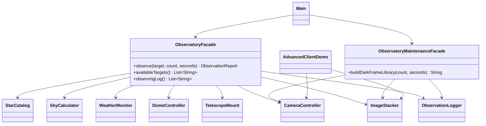

# Observatory Facade (Assignment #4, Facade pattern)

An automated observatory session in Java. Running one night of observation needs
eight collaborating classes in a strict order. The **Facade** hides all of that
behind a single call:

```java
ObservatoryFacade observatory = new ObservatoryFacade();
ObservationReport report = observatory.observe("Vega", 12, 30);
```

## Run

```bash
javac -d out $(find src -name '*.java')
java -cp out com.observatory.Main                # client, only uses the facades
java -cp out com.observatory.AdvancedClientDemo  # bypasses the facade on purpose
```

Requires JDK 17+ (tested on 21).

## Structure

```
src/com/observatory/
  Main.java                      Client: uses ONLY the facades
  AdvancedClientDemo.java        Uses subsystem classes directly (allowed by the pattern)
  facade/
    ObservatoryFacade.java            Main facade: observe(target, count, seconds)
    ObservatoryMaintenanceFacade.java Second facade: dark-frame library
    ObservationReport.java            Result as plain data (no subsystem types)
    ObservationException.java         The one checked exception clients see
    SkyConditions.java                Simulated weather (CLEAR / CLOUDY / STORMY)
  subsystem/                     No class here references a facade
    StarCatalog, SkyCalculator, WeatherMonitor, DomeController,
    TelescopeMount, CameraController, ImageStacker, ObservationLogger
    + records (CelestialObject, HorizontalPosition, WeatherReading, Frame, StackedImage)
    + exceptions (SubsystemException and its subclasses)
```

## Class diagram



## How the pattern requirements are met

| Requirement | Where |
|---|---|
| 4+ subsystem classes with real logic | 8 classes in `subsystem/`: altitude/azimuth maths from sidereal time (`SkyCalculator`), weather limits (`WeatherMonitor`), shortest-path dome rotation (`DomeController`), horizon limit and park/track states (`TelescopeMount`), cooling rule (`CameraController`), SNR gain (`ImageStacker`) |
| Facade with small API | `ObservatoryFacade.observe(...)` hides ~15 subsystem calls |
| Optional second facade | `ObservatoryMaintenanceFacade` (camera only, unrelated to dome and mount) |
| Client uses only the Facade | `Main` imports nothing from `subsystem` |
| Subsystem unaware of Facade | `grep -r facade src/com/observatory/subsystem` finds nothing |
| Subsystem usable directly | `AdvancedClientDemo` |

## Clean Code principles applied

1. **Meaningful names.** The API reads like a sentence: `observe("Vega", 12, 30)`, `buildDarkFrameLibrary(20, 60)`. Private steps are named `prepareObservatory`, `captureFrames`, `secureObservatory` instead of being comments inside one long method.
2. **Single Responsibility.** The Facade only coordinates. Weather limits live in `WeatherMonitor`, the altitude limit in `TelescopeMount`, the cooling rule in `CameraController`. The Facade contains no copy of those rules.
3. **No leaking of subsystem details.** `observe` returns `ObservationReport` (primitives and a String) and throws `ObservationException`. Clients never see `Frame`, `StackedImage`, `HorizontalPosition` or any `SubsystemException`.
4. **Small focused classes and methods.** Each subsystem class has one job and most methods are under 15 lines. Immutable `record`s carry data between them.
5. **Proper error handling.** Subsystems throw specific checked exceptions (`UnsafeWeatherException`, `TargetBelowHorizonException`, ...). The Facade catches `SubsystemException` once, logs it and rethrows a single `ObservationException` with the original as cause.
6. **Guaranteed cleanup.** `secureObservatory()` runs in `finally` and uses only operations that cannot throw (`park`, `closeSlit`, `warmUp`), so the dome is never left open after a failure.
7. **Fail fast.** Arguments are validated first (`IllegalArgumentException`), and the horizon check (`assertReachable`) happens before the dome is opened.
8. **No magic numbers.** Limits are named constants (`MAX_CLOUD_COVER_PERCENT`, `MIN_ALTITUDE_DEGREES`, `READY_TEMPERATURE_CELSIUS`).
9. **Dependency on abstractions of time.** `java.time.Clock` is injected, so the demo is deterministic.

## Demo scenarios (`Main`)

1. Clear sky, Vega above the horizon: full session and report.
2. Alpha Centauri: below the horizon, fails before the dome opens.
3. Cloudy sky: rejected by the weather check.
4. Unknown target: rejected by the catalog.
5. Second facade: dark-frame library.

In every failing case the observatory is still secured.
